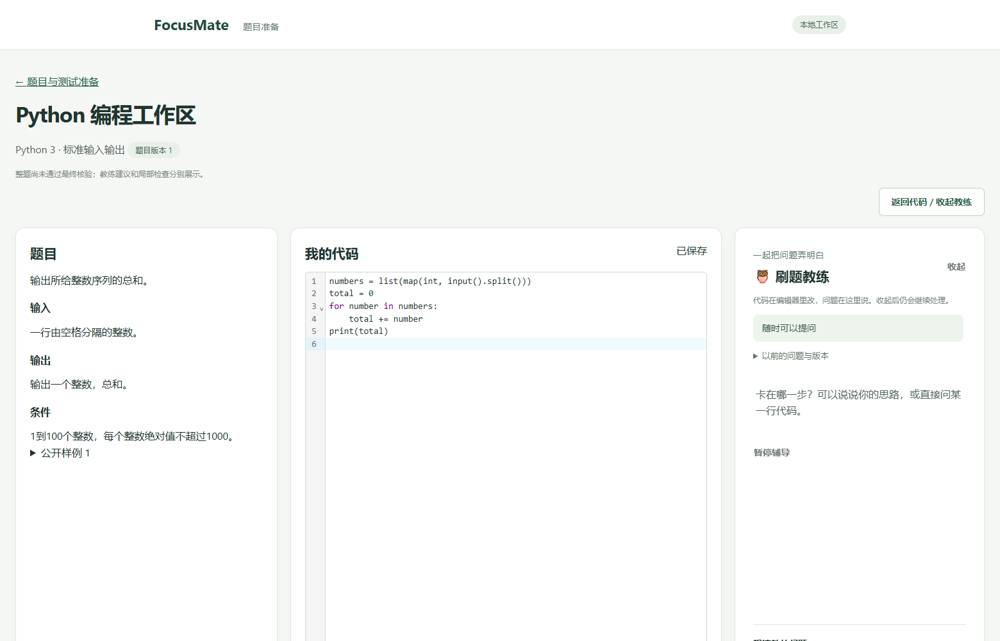
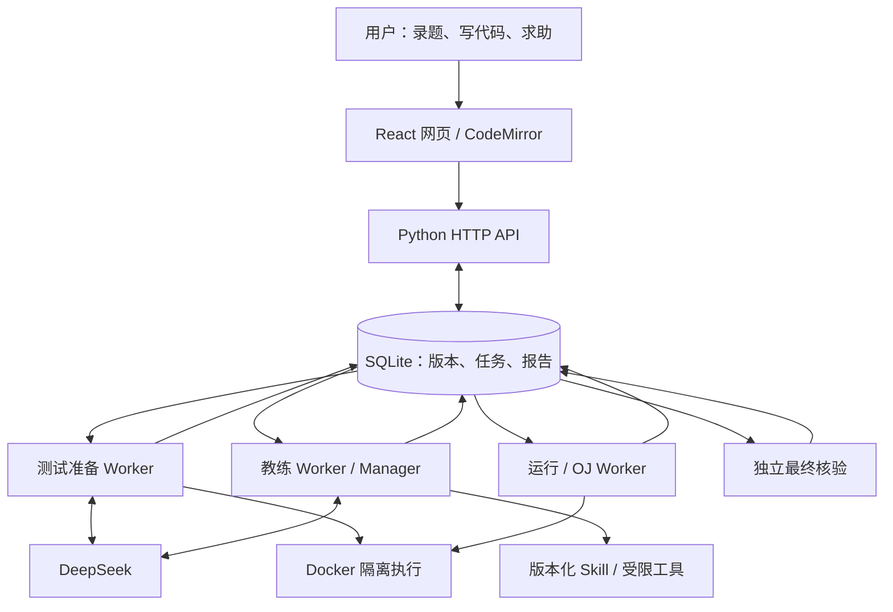

# FocusMate

**把题目、代码、运行结果和局部辅导放在一起的刷题助手。**

FocusMate 在本机运行。你可以录入一道算法题，核对输入输出和条件，在 Python 编辑器中写代码、运行样例、正式提交；遇到困难时，打开教练侧栏讨论当前问题。

它不把一段看起来正确的 AI 回答当成通过证明：**教练建议、局部检查报告、正式判题结果和整题最终核验是不同的记录。** 每份结果关联当时的题目和代码版本。

React · CodeMirror 6 · Python · SQLite · Docker · DeepSeek

## 从一道题开始

1. **录入并确认题目。** AI 整理条件、指出未知项，用户可以修改后确认。核心代码题可提出标准输入输出格式建议，由用户核对采用。
2. **开始写代码。** 编辑器支持 Python 高亮、缩进、名称补全和自动保存。测试材料尚未就绪时，也能先运行公开样例。
3. **运行或提交。** 自定义输入只展示执行结果；正式提交由后台使用对应测试材料判题，历史代码与结果可回看。
4. **按需求助。** 教练读取当前问题、代码和同版本执行事实，给出局部提示；有明确困难时建立工作目标，检查后分别记录已解决、未解决或材料不足。



*截图由隔离测试题生成，不含用户题目或聊天记录；展示界面，不作为模型质量证明。*

## 为什么不只是聊天框

| 用户遇到的情况 | FocusMate 的处理 |
| --- | --- |
| 运行后继续修改代码 | 结果仍指向原代码版本，不把旧结果套到新代码上 |
| 保存回复丢失，或两个页面同时编辑 | 操作编号用于去重；修改序号用于发现冲突，保留本地内容供选择 |
| 用户改变思路，或直接写完提交 | 工作目标可修订、替换或撤回；整题完成不要求逐个通过所有辅导目标 |
| 模型生成的内容格式或引用有错 | 符合条件时自动修复一次，候选仍须通过原检查；不修改用户代码或项目源码 |
| 后台中断、结果迟到 | 持久任务、领取凭证和版本检查控制结果接收；执行情况不明时报告中断，不冒充成功 |

## 系统怎样工作



API 登记和查询长任务；独立 Worker 负责模型调用、测试准备和代码执行。Manager 管理步骤、预算、权限和结果发布，模型负责理解问题和提出帮助。Skill 提供可按需读取的方法说明，不授予执行权限。

测试准备会生成参考程序和测试输入，并进行独立校验、参考对拍及测试资格检查。正式判题使用保存的可信材料；参考程序分歧不会被自动修复掩盖。可信 AC 还要核对当前代码和冻结合同，才能记录整题完成。**这仍不等于用户已经掌握知识，也不是算法正确性的数学证明。**

```text
apps/web/             网页、编辑器和教练侧栏
apps/api/             HTTP 接口、业务服务和存储
src/focusmate/core/   Goal、工作目标、辅导编排和验证
src/focusmate/adapters/ 模型与领域适配
services/             测试准备、运行判题和教练 Worker
skills/               版本化辅导方法
schemas/              数据与接口契约
tests/                自动化测试与独立样例
tools/                启动、检查及可复现的测试工具
```

## 本机启动

需要 **Node.js ≥ 22.12、Python ≥ 3.11、可用的 Docker Linux 容器引擎**。本次发布验证环境为 Windows、Python 3.13 和 Docker Desktop；其他平台尚未做完整验收。

```bash
git clone https://github.com/docohub0609/FocusMate.git
cd FocusMate
python -m venv .venv
```

激活虚拟环境：Windows PowerShell 使用 `.\.venv\Scripts\Activate.ps1`；macOS/Linux 使用 `source .venv/bin/activate`。如果 PowerShell 不允许激活，可直接用 `.\.venv\Scripts\python.exe` 安装依赖，并在 `.env` 中将 `FOCUSMATE_PYTHON` 设置为该解释器的绝对路径。

```bash
python -m pip install -e ".[dev]"
npm ci
```

复制根目录的 `.env.example` 为 `.env`，填写自己的 DeepSeek API Key、接口地址和模型名。**不要提交 `.env`。** 解析题目、准备测试及教练会调用模型并产生费用；模型名请以自己账号实际可用的名称为准。

启动 Docker 引擎后执行：

```bash
npm run oj:build-runner
npm run dev
```

打开 **http://127.0.0.1:5173**。启动器会初始化本地数据库，并启动网页、API、测试准备、样例运行、正式判题和教练服务。在原终端按 `Ctrl+C` 停止整组服务；每次只启动一组。必要进程退出时启动器会报出名称并停止整组服务。

默认业务数据在 `data/focusmate.db`，教练数据在相邻数据库中。重新启动会读取原数据；更新代码时保留 `data/` 和 `.env`。首次构建后的 Runner 镜像可复用，Dockerfile 未变化时不必重建。

可选配置：

| 配置 | 作用 |
| --- | --- |
| `FOCUSMATE_PYTHON` | 明确指定后台使用的 Python 解释器 |
| `FOCUSMATE_DB_PATH` | 改用独立的业务数据库路径 |
| `FOCUSMATE_TEMP_DIR` | 把本次服务的临时文件放到已有目录，不修改全局设置 |

终端已有环境变量优先于 `.env`。遇到“网页可开但任务不动”，先看启动终端和 Docker 引擎；不要反复提交掩盖后台故障。

## 验证与测试

```bash
npm run check
npm run test:web-browser
npm run test:web-editor
npm run test:web-coach
```

`check` 包括架构边界、Node/Python 测试、网页类型检查和构建。浏览器测试默认使用本机 Edge；可通过 `PLAYWRIGHT_CHANNEL` 选择已安装的兼容浏览器。

默认浏览器回归使用隔离数据和模拟模型/执行器，验证交互和恢复行为，**不代表真实模型准确率**。真实 Docker 检查使用 `python tools/run-oj-integration.py`；涉及真实模型的入口须显式提供配置，不能把跳过的集成测试算作通过。更多边界见 [测试说明](tests/README.md)。


## 许可

项目原创代码采用 [MIT License](LICENSE)。第三方依赖保留各自许可，详见 [第三方说明](THIRD_PARTY_NOTICES.md)。
